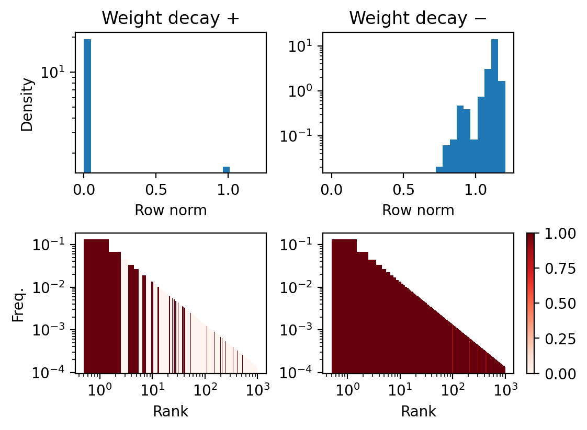
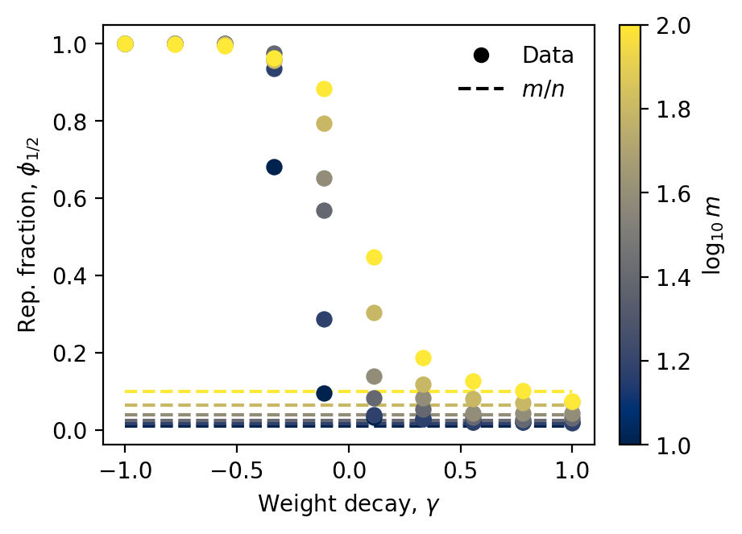
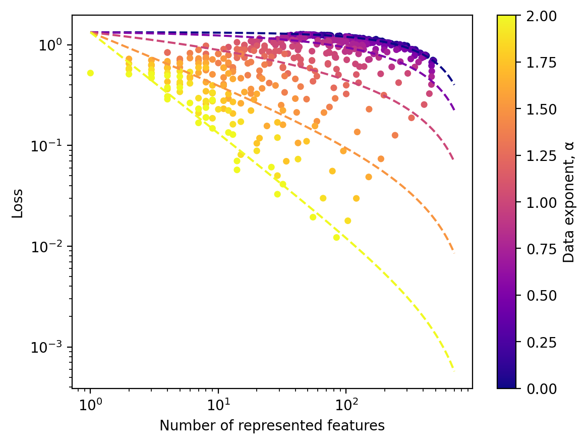
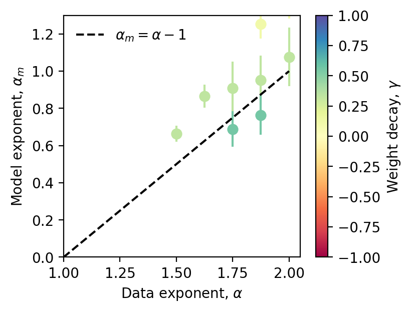
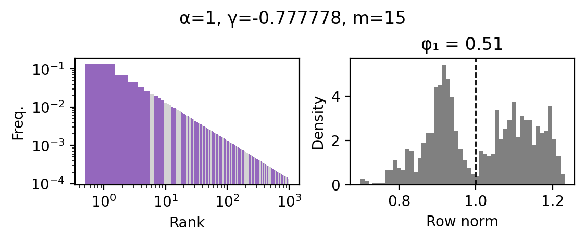
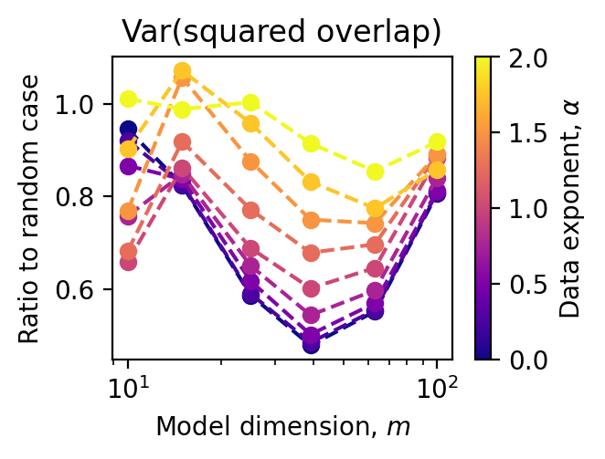

# superposition_scaling_reproduction
Reproduction of Superposition Yields Robust Neural Scaling (NeurIPS 2025)

This repository reproduces the core toy experiments and results (figures 3, 4, 5a, 5b, 5c) from Superposition Yields Robust Neural Scaling (NeurIPS 2025) by Yizhou Liu, Ziming Liu, Jeff Gore from scratch. It does not currently implement the final few experiments working with open-source LLMs and Chinchilla scaling laws (but may be updated in the future).

## Background

This paper uses simple, tied-weight autoencoder toy models to investigate loss in the weak and strong superposition regimes, with data sampled as a vector of sparse, independent features with feature probabilities decaying according to an inverse power law distribution. The superposition regime is then robustly tuned by modifying optimizer weight decay. In the weak superposition regime, loss is demonstrated to scale with the sum of frequencies of ignored features. In the strong superposition regime, loss scales with interactions between representation along with $\frac{1}{m}$ for model dimension m. 

## Results
### Figure 3: Weight decay controls superposition

| Paper | Reproduction |
|:---:|:---:|
|  |   |
| Figure 3a–b | Figure 3a–b |

- 3a: same qualitative split. With negative weight decay the row norms spread wider (about 0.75–1.2, with a small bump near 0.9) than the paper's tight cluster just above 1.
- 3b: closely matches the paper.

### Figure 4: Weak superposition

| Paper | Reproduction |
|:---:|:---:|
|  |   |
| Figure 4a–b | Figure 4a–b |

- 4a: same trend, with points following the theory curves.
- 4b: the fitted exponents mostly sit above the α_m = α − 1 line, while the paper's lie closer to it. The selected points cover α = 1.5–2 (the paper's reach down to 1.25), and one point (α = 2, α_m ≈ 1.35) falls above the plotted range.

### Figure 5: Strong superposition

| Paper | Reproduction |
|:---:|:---:|
|  | <br> |
| Figure 5a–e (panels a–c reproduced) | Figure 5a–b (top), 5c (bottom) |

- 5a–b: same bimodal row-norm distribution around 1. The peaks are closer to 1 than in the paper, and the panels are side by side instead of stacked.
- 5c: higher α gives a higher ratio, as in the paper. For small α at the largest m, the paper's ratio drops toward 0, while here it dips at m ≈ 40 and rises back to about 0.8 at m = 100. This reproduction uses γ = −0.56.

## Setup

### Model and data

The model is a tied-weight autoencoder, $y = \mathrm{ReLU}(W W^\top x + b)$, with $W \in \mathbb{R}^{n \times m}$.
Each row $W_i$ is the embedding of feature $i$.

- **Features:** n = 1000.
- **Model dimension:** m ∈ {10, 15, 25, 39, 63, 100}.
- **Data:** feature i is active with probability $p_i \propto i^{-\alpha}$, normalized so that one feature is active per sample on average. Active features take values drawn uniformly from [0, 2].
- **Data exponent:** α ∈ {0, 0.125, …, 2} (17 values).

### Training

- **Optimizer:** AdamW, adapted from the authors' [`exp/adamw.py`](https://github.com/liuyz0/SuperpositionScaling/blob/main/exp/adamw.py).
  - For γ ≥ 0 it applies standard decoupled weight decay.
  - For γ < 0 it applies a row-wise term that pushes each row norm of W toward 1.
- **Weight decay:** γ takes 10 evenly spaced values in [−1, 1] and applies to W only. The bias b has no weight decay.
- **Schedule:** 20,000 steps, batch size 2048, MSE loss. The learning rate is 1e-2 with linear warmup over the first 10% of steps (2,000), then cosine decay.
- **Runs:**
  - Figures 4 and 5 use one sweep over every combination of α, γ and m: 17 × 10 × 6 = 1,020 runs.
  - Figure 3b uses its own 6 × 10 sweep over m and γ at α = 1.
  - Figure 3a uses two runs at m = 100, α = 1, γ = ±1.

These settings follow the authors' toy-model sweep script, [`exp/exp-10.py`](https://github.com/liuyz0/SuperpositionScaling/blob/main/exp/exp-10.py).

### Evaluation

- **Test loss:** MSE averaged over 100 freshly sampled batches.
- **phi_1/2:** fraction of features with row norm ‖W_i‖ > 0.5, i.e. features the model represents.
- **phi_1:** fraction of features with row norm ‖W_i‖ > 1. Figure 5 uses this to mark strongly represented features.
- **Figure 4b:** the 9 (α, γ) settings whose learned $W W^\top$ is closest to the no-superposition solution (identity on the top m features) in worst-case Frobenius norm across m. The model exponent α_m is the negative slope of a log–log fit of test loss against m.
- **Figure 5c:** the variance of squared overlaps between normalized rows with norm > 1, divided by the variance for random unit vectors in m dimensions, $\frac{2(m-1)}{m^2(m+2)}$. Computed at γ = −0.56.

## Repo layout

```
notebooks/reproduction.ipynb   training, export and plotting code for every figure
data/*.npz                     arrays exported from the trained checkpoints (one file per figure)
figures/                       generated figures, .png and .pdf
```

## How to run

### Recreate the figures locally

The trained checkpoints are not included, but `data/` holds everything the plots need, so a CPU is enough.

```bash
pip install numpy torch matplotlib scipy jupyter
jupyter notebook notebooks/reproduction.ipynb
```

Run all cells. Cells that need checkpoints start with `%%script echo "skip ..."` and skip themselves.
The plotting cells load `data/*.npz` and write to `figures/`.

### Retrain on Colab

1. Open the notebook in Colab on a GPU runtime and mount Google Drive.
2. Set `CKPT_ROOT` in the config cell to a Drive folder.
3. Delete the `%%script echo` line from the training and export cells you want to run.

Training cells skip any run whose checkpoint already exists, so an interrupted sweep picks up where it stopped.
Export cells write fresh `.npz` files to `DATA_DIR`.

## Acknowledgements

The AdamW optimizer with negative weight decay is adapted from the authors' code,
[liuyz0/SuperpositionScaling](https://github.com/liuyz0/SuperpositionScaling), and the paper figures above
are from that repository. Please cite the original paper:

```bibtex
@article{liu2025superposition,
  title={Superposition Yields Robust Neural Scaling},
  author={Liu, Yizhou and Liu, Ziming and Gore, Jeff},
  journal={Advances in Neural Information Processing Systems},
  volume={38},
  pages={159269--159305},
  year={2025}
}
```

## License

MIT; see [LICENSE](LICENSE).
